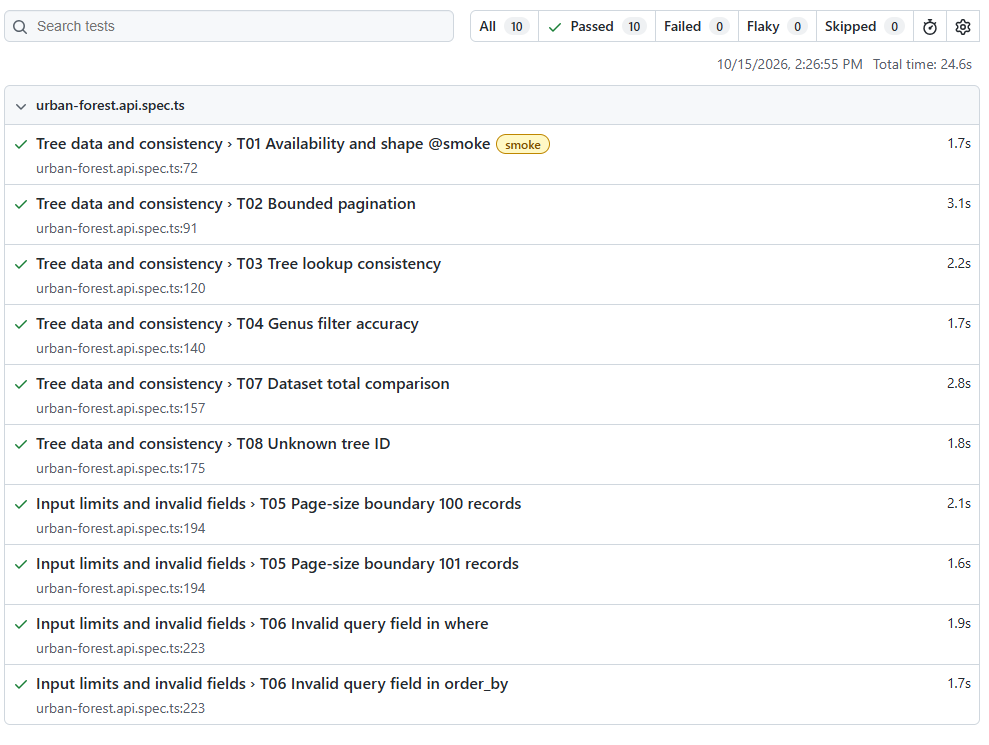
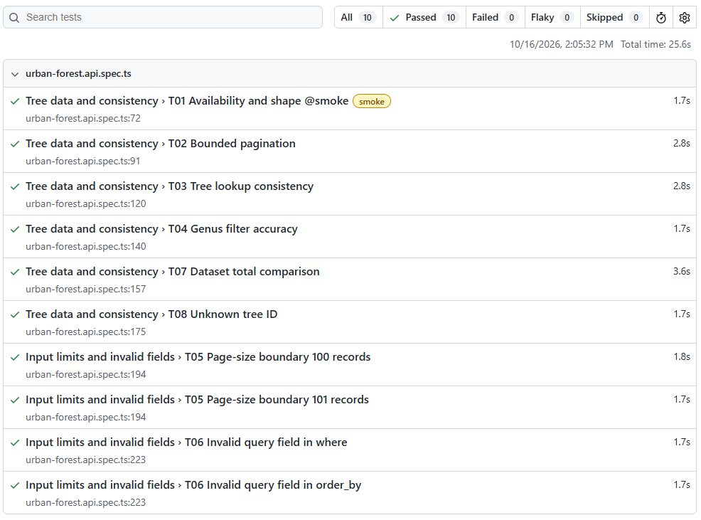

# Melbourne Urban Forest API tests

I began this API testing project in 2026 as part of my upskilling after The Test Tribe Playwright course. It is separate from my earlier employment. I chose the City of Melbourne's public Urban Forest dataset because I could check real tree responses through read-only requests. No client requirements were supplied.

I used Playwright to check a small consumer workflow. My checks covered retrieving a page of trees, moving to the next page, looking up a returned tree, filtering by genus and comparing the data and metadata totals. They also check how the API responds to an excessive page size, invalid fields and an unused tree ID. The [test plan](evidence/test-plan.md) sets the scope. The [matrix](evidence/test-matrix.md) lists the eight conditions and the basis for each expected result.

## Where to inspect the evidence

I set out the checks in the plan and matrix before writing the Playwright suite. I linked the code and dated results here because they show how I carried out those checks and what the API returned.

- The [test plan](evidence/test-plan.md) and [matrix](evidence/test-matrix.md) explain the scope and expected results for T01–T08.
- The [Playwright specification](tests/urban-forest.api.spec.ts) contains the checks. The [JSON cases](test-data/boundary-cases.json) supply the two T05 page sizes.
- The [Milestone-A](evidence/Milestone-A/README.md), [Milestone-B](evidence/Milestone-B/README.md) and [Milestone-C](evidence/Milestone-C/README.md) folders lead to the dated preparation and run evidence.
- The [run summary](evidence/run-summary.md) compares the complete runs. The [findings log](evidence/findings.md) explains the observations and what the results cannot establish.

## View the saved Playwright reports

GitHub displays the saved HTML files as file contents instead of Playwright report pages. I added one screenshot from each report because I wanted both dated results to be visible in this README.

### 15 October 2026 baseline



The [baseline HTML file](evidence/Milestone-B/html-report/index.html) contains the individual case results. Its [run summary](evidence/Milestone-B/baseline-run-summary.json) gives the date and command.

### 16 October 2026 repeat execution



The [repeat-run HTML file](evidence/Milestone-C/html-report/index.html) contains that run’s individual case results. Its [run summary](evidence/Milestone-C/repeat-run-summary.json) gives the date and command.

The screenshots may look alike because all ten Playwright cases passed on both dates. Those ten cases cover eight matrix conditions because T05 and T06 each used two inputs. You can download either HTML file from its GitHub page and open it locally if you want to inspect the full report.

## Applying the course to this project

The Test Tribe Playwright course included a lesson on GET API automation. It showed how to use Playwright's `request` fixture, read a JSON response and check both its status and values with `expect`. Other lessons covered grouping tests, adding tags, reading test data from JSON and reviewing the built-in HTML report.

I used those techniques to build checks for Melbourne's public Urban Forest API. I had to choose the requests and expected results for this dataset. The [test specification](tests/urban-forest.api.spec.ts) checks real tree responses, including the order and uniqueness of IDs across two pages. For T05, I adapted the course's JSON test-data approach to try the City's published page-size limit of 100 and a request at 101. T01 carries an `@smoke` tag. The [saved results](evidence/run-summary.md) let me compare what the complete suite returned on two dates.

## Results

I first confirmed access and examined the response fields on [13 October](evidence/Milestone-A/README.md). That preparation was not a complete T01–T08 run. The [Milestone-B baseline](evidence/Milestone-B/README.md) followed on 15 October. On 16 October, I ran the same suite again for the [Milestone-C repeat execution](evidence/Milestone-C/README.md). I chose a second date because the 15 October result showed how the API responded during that run only. I wanted to check the same expectations when I ran the suite again. All ten Playwright test cases passed in each complete run.

The matrix has eight conditions. T05 and T06 each use two inputs, so they appear as four of the ten cases. Each run made 13 GET requests because setup fetched a current tree before the checks, while T02 and T07 each needed two responses to make their comparisons. The [shared run summary](evidence/run-summary.md) compares the dates, results and source identities. The [findings log](evidence/findings.md) explains what those results support. Milestone-A keeps the dated preflight log because I used that stage to confirm API access and examine the tree fields. Milestones B and C each keep a dated complete-run result and detailed evidence for T01–T08. The 13 saved request summaries matched across the dates. The same five source-file hashes also appear in both run summaries. That means the saved test specification, cases, configuration and package files had identical content on the two dates. Those hashes compare my test files, not the live API or its tree data. I compared the saved suite results because I wanted to see whether the same assertions still passed on 16 October. I was not testing the effect of an identified City API change. I did not monitor the service between the two runs, so these results describe its responses on those dates rather than throughout the interval.

| Matrix ID | What the assertion checks |
| --- | --- |
| T01 | HTTP 200 JSON with a non-empty tree page, numeric total and a row with populated `com_id` and `genus`. |
| T02 | Two five-row pages in ascending `com_id` text order, with no repeated ID across the pages. |
| T03 | A lookup returns the source tree's `com_id` and `genus`. |
| T04 | The genus filter returns at least one row and every returned genus matches the filter. |
| T05 | `limit=100` succeeds. `limit=101` returns a JSON error. |
| T06 | Invalid fields in `where` and `order_by` produce separate, understandable JSON errors. |
| T07 | The unfiltered data total equals the dataset metadata total within the run. |
| T08 | An unused `com_id` returns HTTP 200, zero total and an empty array. |

## Run the suite

Install Node.js and pnpm, then run these commands from the repository root:

```powershell
pnpm install --frozen-lockfile --ignore-scripts
pnpm test
```

The tests are in [one Playwright specification](tests/urban-forest.api.spec.ts), with the T05 values in [JSON](test-data/boundary-cases.json). The [configuration](playwright.config.ts) uses one worker, no parallel execution and no retries. The script pauses 700 ms before each GET request. It uses only read-only calls. Stop if the service returns HTTP 403, HTTP 429 or an access challenge. When I run `pnpm test`, Playwright’s configured HTML reporter writes the new local report to `playwright-report/`. The dated reports under [Milestone-B](evidence/Milestone-B/README.md) and [Milestone-C](evidence/Milestone-C/README.md) are retained separately, so a new local run does not replace their evidence.

## Scope and sources

These checks cover a small sample of one public dataset. They do not inspect every tree entry, establish inventory accuracy, test the website interface or exercise data-changing, load or security operations. Equal totals from two endpoints show agreement within a run, not an independent count of physical trees. The two passing dates show that the sampled requests worked during each run. I chose complete runs on separate dates because one passing run showed only how the API responded at that time. I did not monitor the service between them. An outage during that interval would not appear in either saved result, so the two passes do not establish continuous availability.

On 13 October, I checked the deep-paging boundary during Milestone-A. The API returned HTTP 200 for limit=100 with offset=9900, although the published guidance says their sum should be below 10,000. I chose adjacent five-row pages for T02 and the separate 100/101 page-size boundary for T05. I repeated those eight defined conditions on 15 and 16 October, but I did not make another deep-paging request. Being part of the preflight did not prevent me from repeating it. I left it outside the later checks as a scope choice. Because T02 used offsets 0 and 5 and T05 did not use offset=9900, their passing results cannot show how the API would have answered the 13 October request on either later date. The [findings log](evidence/findings.md) keeps that HTTP 200 response as a dated observation. The [City dataset page](https://data.melbourne.vic.gov.au/explore/dataset/trees-with-species-and-dimensions-urban-forest/information/) and [Explore API reference](https://help.opendatasoft.com/apis/ods-explore-v2/explore_v2.1.html) provide the published fields and query rules used to design the checks. Sections 1.4.1 and 5.1.3 of the [ISTQB Foundation Level syllabus](https://istqb.org/wp-content/uploads/2024/11/ISTQB_CTFL_Syllabus_v4.0.1.pdf) were supplementary references for retaining results and reviewing the plan's completion criteria.

## Licence

Files outside `evidence/` are available under the [MIT Licence](LICENSE). My original writing in the evidence documents is available under [CC BY-ND 4.0](evidence/LICENSE.md).